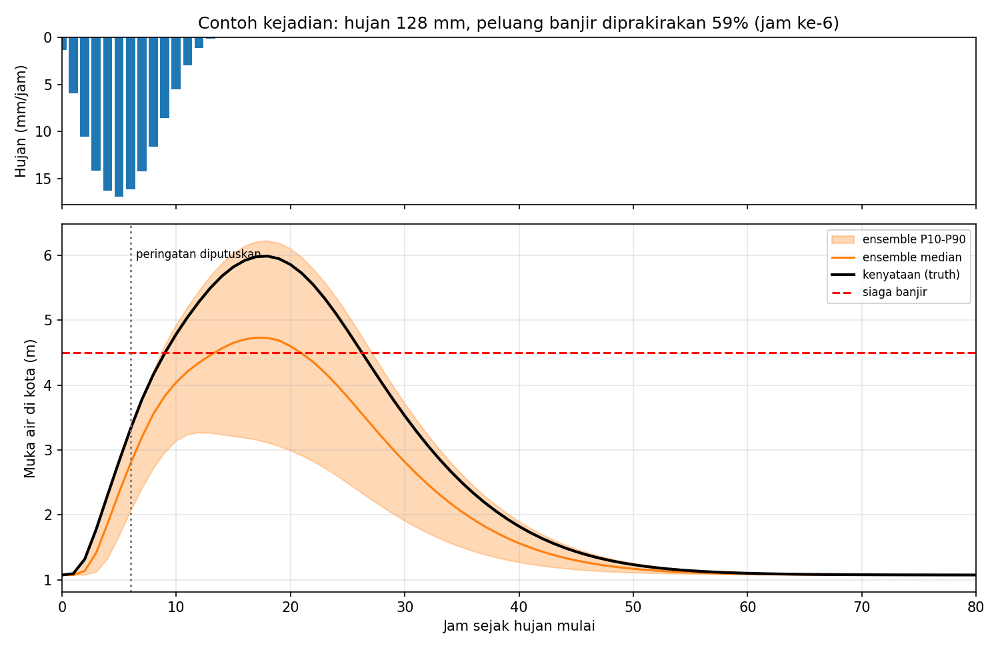
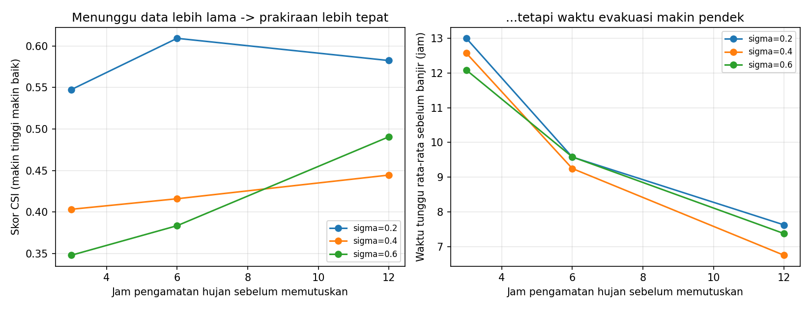
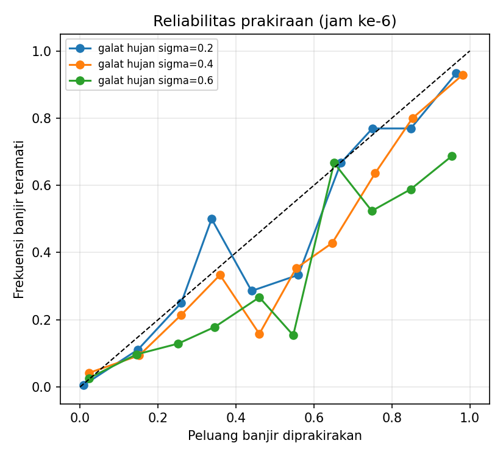
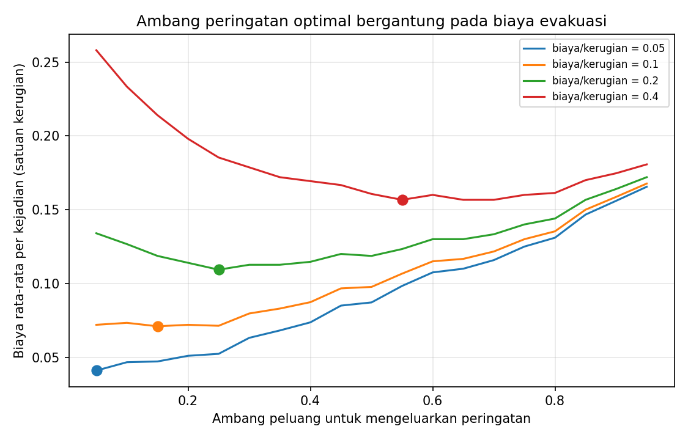

# 🌧️ Prakiraan Banjir Sungai Probabilistik dengan Ensemble di HPC

> **Studi kasus** berdasarkan kuliah umum *"Bridging Global Infrastructure to Address Local Challenge with HPC"*
> (Asst. Prof. Dr. Worawan Diaz Carballo, Thammasat University, 5 Okt 2026).
> Pemateri mencontohkan prakiraan banjir (Bangladesh): tahu lebih dulu agar warga bisa pindah ke tempat
> aman dan menyiapkan logistik. Proyek ini mengangkat gagasan itu ke konteks DAS di Indonesia,
> dengan peran Anda sebagai **integrator**: *masalah lokal → workflow komputasi → infrastruktur HPC*.

⚠️ **Disclaimer:** DAS, parameter, dan semua angka di repositori ini **sintetis/asumsi** untuk pembelajaran.
Ini bukan kalibrasi sungai nyata dan tidak boleh dipakai untuk peringatan dini sungguhan.

---

## 1. Masalah Lokal

Hujan lebat di hulu membuat muka air sungai di kota naik beberapa jam kemudian. Petugas harus memutuskan
**kapan mengeluarkan peringatan banjir**, padahal hujan berikutnya belum diketahui:

- Peringatan **terlalu cepat** → sering salah (*false alarm*), warga evakuasi sia-sia, lama-lama tidak dipercaya.
- Peringatan **terlalu lambat** → waktu evakuasi habis.

> **Pertanyaan studi kasus:** berapa peluang banjir yang perlu dicapai sebelum peringatan dikeluarkan, dan seberapa
> lama sebaiknya kita menunggu data hujan sebelum memutuskan?

Prakiraan tunggal tidak cukup. Kita perlu **ensemble** (ratusan kemungkinan hujan lanjutan) dan perlu menguji
cara ini pada **ribuan kejadian hujan**. Itulah beban kerja yang cocok untuk HPC.

## 2. Pemetaan dari Materi Pemateri ke Proyek Ini

| Materi kuliah | Implementasi di repo |
|---|---|
| *Local needs*: banjir, bencana, ketahanan pangan | Prakiraan banjir di kota hilir sebuah DAS |
| Prakiraan cuaca makin cepat berkat superkomputer | Ensemble 100–200 anggota per kejadian |
| Peran **integrator**: workflow dari data → model → hasil | `sweep.py` → `analyze.py` → grafik di `results/` |
| Menjalankan job lewat **batch script** (SLURM) | `slurm/job_sweep.sh` |
| **MPI**: banyak CPU bekerja bersamaan | backend `mpi` di `sweep.py` (mpi4py) |
| Unduh hasil lalu visualisasi di komputer pribadi | `scripts/analyze.py` |
| *Artifact description*: dapat diulang & dipakai ulang | README ini, seed acak tetap, `requirements.txt` |
| Kolaborasi dengan pakar domain | Bagian 9 |

## 3. Desain Model

**DAS sintetis** ±500 km² dengan 5 sub-DAS (hulu → hilir) dan titik kota di hilir.

**Rantai perhitungan** (satu langkah = 1 jam, 120 jam):

```
hujan per jam ─► SCS Curve Number ─► hidrograf satuan gamma ─► debit di kota ─► kurva debit-muka air ─► muka air (m)
                 (limpasan)           (+ waktu tempuh sungai)
```

**Ketidakpastian yang dimodelkan:**
- total hujan, durasi, dan pola waktunya (lognormal / acak);
- kelembapan tanah awal: kering 25%, normal 45%, basah 30%;
- sebaran hujan antar sub-DAS.

**Eksperimen prakiraan** (satu "kejadian" = satu unit kerja paralel):
1. Satu hujan "kenyataan" (*truth*) dibangkitkan dan menghasilkan hidrograf sebenarnya.
2. Pada jam ke-`obs_hours`, pengamat hanya tahu hujan yang sudah turun.
3. Hujan sisa diprakirakan oleh `n_members` anggota ensemble dengan galat `forecast_error` (σ lognormal).
4. Keluaran: `p_exceed` = proporsi anggota yang muka airnya melewati **siaga banjir (4,5 m)**.
5. Dibandingkan dengan kenyataan, lalu dihitung POD, FAR, CSI, skor Brier, dan waktu tunggu.

| Parameter | `demo` (laptop) | `full` (HPC) |
|---|---|---|
| Galat prakiraan hujan σ | 0,2 / 0,4 / 0,6 | 0,1 sampai 0,8 (7 nilai) |
| Jam pengamatan sebelum memutuskan | 3 / 6 / 12 | 3, 6, 9, 12, 18, 24 |
| Anggota ensemble | 100 | 200 |
| Kejadian hujan per konfigurasi | 300 | 2.000 |
| **Total kejadian** | **2.700** | **84.000** |

## 4. Struktur Repositori

```
hpc-banjir-bengkulu/
├── README.md
├── requirements.txt
├── LICENSE
├── src/floodcast/
│   ├── model.py        # hidrologi: CN + hidrograf satuan + rating curve + ensemble
│   └── sweep.py        # sweep kejadian x konfigurasi (backend: serial | mp | mpi)
├── slurm/job_sweep.sh  # batch script SLURM
├── scripts/
│   ├── analyze.py           # evaluasi prakiraan + 4 grafik
│   └── benchmark_scaling.py # ukur speed-up
└── results/            # hasil run demo (CSV + PNG)
```

## 5. Cara Menjalankan

### 5.1 Di laptop
```bash
git clone https://github.com/<username>/hpc-banjir-bengkulu.git
cd hpc-banjir-bengkulu
python -m venv .venv && source .venv/bin/activate     # Windows: .venv\Scripts\activate
pip install numpy pandas matplotlib                    # mpi4py tidak wajib di laptop
export PYTHONPATH=src                                  # PowerShell: $env:PYTHONPATH="src"

python -m floodcast.sweep --preset demo --backend mp --workers 4
python scripts/analyze.py
```

### 5.2 Di HPC (SLURM + MPI)
```bash
ssh <user>@<alamat-hpc>                  # kunci publik sudah didaftarkan ke portal
git clone https://github.com/<username>/hpc-banjir-bengkulu.git && cd hpc-banjir-bengkulu
module load Python/3.11 OpenMPI          # sesuaikan dengan `module avail`
python -m venv .venv && source .venv/bin/activate
pip install -r requirements.txt

# edit slurm/job_sweep.sh (account, partition, modul), lalu:
sbatch slurm/job_sweep.sh
squeue -u $USER                          # pantau antrean
# unduh results/sweep_full.csv ke laptop (scp/rsync), lalu:
python scripts/analyze.py results/sweep_full.csv
```

Pembagian kerja: kejadian ke-*i* dikerjakan rank MPI `i mod jumlah_rank` (round-robin); hasil dikumpulkan
ke rank 0 dan ditulis ke CSV. Setiap kejadian independen, sehingga speed-up diharapkan mendekati linear.

## 6. Hasil Run Demo (2.700 kejadian, serial, ±5 detik)

Frekuensi banjir pada kejadian hujan lebat sintetis: **20,3%**. Ambang peringatan: peluang ≥ 30%.

| Galat hujan σ | Jam pengamatan | Skor Brier ↓ | POD ↑ | FAR ↓ | CSI ↑ | Waktu tunggu (jam) |
|---|---|---|---|---|---|---|
| 0,2 | 3 | 0,08 | 0,85 | 0,40 | 0,55 | 13,0 |
| 0,2 | 6 | 0,07 | 0,87 | 0,33 | 0,61 | 9,6 |
| 0,2 | 12 | 0,07 | 0,87 | 0,36 | 0,58 | 7,6 |
| 0,4 | 3 | 0,12 | 0,82 | 0,56 | 0,40 | 12,6 |
| 0,4 | 6 | 0,11 | 0,77 | 0,53 | 0,42 | 9,3 |
| 0,4 | 12 | 0,09 | 0,79 | 0,49 | 0,44 | 6,8 |
| 0,6 | 3 | 0,15 | 0,79 | 0,62 | 0,35 | 12,1 |
| 0,6 | 6 | 0,13 | 0,84 | 0,59 | 0,38 | 9,6 |
| 0,6 | 12 | 0,09 | 0,85 | 0,46 | 0,49 | 7,4 |

(POD = proporsi banjir yang berhasil diperingatkan; FAR = proporsi peringatan yang ternyata salah;
CSI = skor gabungan; waktu tunggu = selang antara peringatan dan muka air melewati siaga.)

**Ambang peringatan optimal** (σ = 0,4, jam ke-6), menurut rasio *biaya evakuasi / kerugian jika banjir tidak diperingatkan*:

| Biaya/kerugian | 0,05 | 0,1 | 0,2 | 0,4 |
|---|---|---|---|---|
| Ambang optimal peluang | ≥ 5% | ≥ 15% | ≥ 25% | ≥ 55% |






## 7. Interpretasi

1. **Ada pertukaran antara ketepatan dan waktu.** Menunggu data hujan lebih lama (3 → 12 jam) cenderung
   menaikkan ketepatan, tetapi waktu tunggu sebelum banjir menyusut sekitar separuhnya (sekitar 13 → 7 jam).
2. **Ambang peringatan bukan angka tunggal.** Ambang optimal mengikuti rasio biaya/kerugian: jika evakuasi murah
   (misalnya naik ke tempat tinggi sementara), peringatan boleh dikeluarkan pada peluang rendah (5 sampai 15%);
   jika evakuasi mahal, tunggu peluang lebih tinggi. Pola ini sesuai teori keputusan biaya-kerugian.
3. **Galat prakiraan hujan sangat berpengaruh.** Galat σ = 0,2 menghasilkan CSI jauh lebih baik daripada σ = 0,4 sampai 0,6.
   Karena itu investasi pada data hujan yang baik (radar/pos hujan) berdampak langsung.
4. **Peringatan sering salah (FAR 33 sampai 60%)**, wajar pada prakiraan probabilistik. Komunikasi ke warga perlu
   menjelaskan bahwa peringatan itu soal *peluang*, bukan kepastian.

⚠️ Pada preset `demo`, tiap konfigurasi hanya 300 kejadian, jadi angka kecil seperti 0,38 vs 0,35 belum signifikan
(ada derau sampling). Inilah alasan preset `full` dengan 2.000 kejadian per konfigurasi dijalankan di HPC.

## 8. Keterbatasan & Pengembangan

**Keterbatasan:** DAS sintetis; model limpasan sangat sederhana (CN + hidrograf satuan) tanpa genangan 2D;
pola waktu hujan sisa dianggap diketahui (hanya besarnya yang tidak pasti); satu sungai dan satu titik kota;
tidak ada kalibrasi terhadap data debit nyata.

**Ide pengembangan, dari mudah ke sulit:**
- [ ] Tambah parameter lain ke sweep (ambang siaga, jumlah sub-DAS) dan lihat pengaruhnya.
- [ ] Ganti sebaran hujan dengan data historis (BMKG/CHIRPS/GPM IMERG) untuk satu DAS nyata.
- [ ] Gunakan DEM (DEMNAS) untuk menurunkan luas sub-DAS dan waktu tempuh yang nyata.
- [ ] Kalibrasi parameter dengan data tinggi muka air dari pos duga air (BWS/BBWS).
- [ ] Ganti hidrologi sederhana dengan model fisik (mis. HEC-HMS/LISFLOOD) dan jalankan ensemble di HPC.
- [ ] Peta genangan (model 2D) per skenario, lalu hitung populasi terdampak.

## 9. Kolaborasi: Kebutuhan Pakar Domain

Seperti pesan pemateri, ilmuwan komputer tidak bisa bekerja sendiri. Untuk membawa proyek ini ke dunia nyata, libatkan:
ahli hidrologi/teknik sumber daya air, BMKG (data hujan dan prakiraan), BWS/BBWS (pos duga air),
BPBD (ambang siaga dan prosedur evakuasi), dan pemerintah kota.

## 10. Catatan Reproduksibilitas (*Artifact Description*)

- Seed acak tetap per kejadian (`seed` = 0…N-1). Kejadian "kenyataan" identik di semua konfigurasi dengan seed yang sama,
  sehingga perbandingan antar konfigurasi adil.
- Python ≥ 3.10; paket di `requirements.txt`.
- Waktu serial demo: ±5 detik pada 1 core (±2 ms per kejadian dengan 100 anggota). Preset `full` (84.000 kejadian,
  ±6 ms per kejadian dengan 200 anggota) sekitar 8 menit serial; benchmark speed-up multi-core belum diukur di mesin pembuat (hanya 1 core):
  jalankan `python scripts/benchmark_scaling.py` di mesin Anda.
- Backend MPI **belum diuji** di cluster pada versi ini; backend `serial` dan `mp` sudah diuji.

## 11. Rencana Kerja Mahasiswa (±4 minggu)

| Minggu | Target |
|---|---|
| 1 | Jalankan demo, pahami `model.py`, ubah satu parameter dan amati hasilnya |
| 2 | Tambah variabel sweep baru; tulis interpretasi sendiri |
| 3 | Daftar akun HPC (pusat HPC kampus/BRIN/kompetisi), jalankan `sbatch` pertama dengan preset `full` |
| 4 | Ganti hujan sintetis dengan data historis satu DAS nyata; tulis laporan + presentasi |

## Lisensi
MIT.
